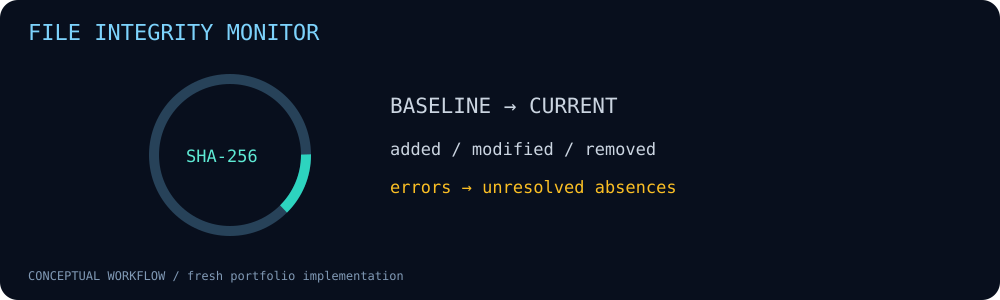

# File Integrity Monitor



One-shot SHA-256 baselines and JSON reports for added, modified and removed regular files.

**Fresh portfolio implementation • Python 3.10+ • Standard library only**

## Run

```bash
python3 --version
python3 monitor.py baseline /path/to/watched /path/outside/watched/baseline.json
python3 -m unittest discover -s tests -v
```

```bash
python3 monitor.py check /path/to/watched /path/outside/watched/baseline.json
```
Use `python3 examples/demo.py` for a self-contained temporary-directory demonstration.

## Implemented behavior

- Compares file content hash, size and Unix permission mode.
- Skips symlinks and non-regular files; detects ordinary file mutation during hashing using before/after metadata.
- Coverage errors turn absent files into unresolved absences instead of confirmed deletions.
- Refuses baseline overwrite and baseline placement inside the watched tree.
- Check exit codes: 0 complete coverage with no changes, 1 complete coverage with changes, 2 incomplete coverage or errors (even if changes also exist).
- Reports expose `baseline_complete` and `current_complete` separately, with saved baseline errors/skips retained as `baseline_errors` and `baseline_skipped`.
- Validates loaded snapshots before comparison, rejecting unsafe paths, malformed hashes, invalid sizes/modes and ambiguous coverage fields.

### Coverage-aware checks

`complete` is true only when both snapshots have no collection errors or skipped
paths. An incomplete current scan still reports known changes but does not call
unobserved baseline paths confirmed removals. Gaps in a saved baseline also prevent
a complete verdict, even if a later scan has no gaps. An `added` path means it was
not recorded in the baseline; it might have existed in a previously skipped area.

Baseline creation still permits skipped paths and reports them explicitly; success
means the baseline was saved, not that coverage was complete. Before comparison,
the monitor validates both snapshot structures. File and skipped-path entries must
be canonical relative POSIX paths; file records require a lowercase SHA-256 digest,
a non-negative size and a valid permission mode. Malformed baselines fail closed
with exit code 2 instead of influencing an integrity verdict. Protect the saved
baseline and resolve skipped paths before relying on a clean check. This changes
earlier check behavior where skipped paths could return exit 0.

Baseline JSON is read as UTF-8 and duplicate object keys are rejected at every
nesting level before schema validation. Repeated file records or coverage fields
cannot silently replace earlier values. Such inputs exit 2 with a diagnostic and
no integrity report. This validates representation, not baseline authenticity.

## Scope and limitations

Not a daemon or trusted forensic acquisition tool. No ACLs, ownership, xattrs, signatures, remote storage or authenticated baseline. Parent-directory races and hostile privileged tampering are outside its guarantees; scan a quiescent trusted tree. Linux/POSIX target; O_NOFOLLOW support matters. Hashing large trees can be expensive; no size limit. Skipped paths make coverage incomplete and check exits 2. Store and protect baselines separately; whoever can alter both baseline and target can hide changes. Root path must match the baseline.

## Validation

22 unit tests passed locally on Python 3.12.14, including malformed-baseline, unsafe-path, coverage-gap and CLI exit-code regression tests. Synthetic CLI examples were executed and results are included under `examples/`. No customer data, historical lab results or production effectiveness is claimed. CI configuration is supplied; remote CI status must be checked after publishing.

## Files

- `monitor.py` — implementation and CLI.
- `tests/test_main.py` — regression and boundary tests.
- `examples/` — synthetic inputs and generated output.
- `assets/workflow.svg` — project-specific animation with reduced-motion support.
- `.github/workflows/ci.yml` — pinned-action CI.

## Safe operation

Use inputs and hosts you own or are authorized to assess. Review reports before publication; real files, headers and logs can contain sensitive information. These tools do not establish that a system is secure or compromised.


